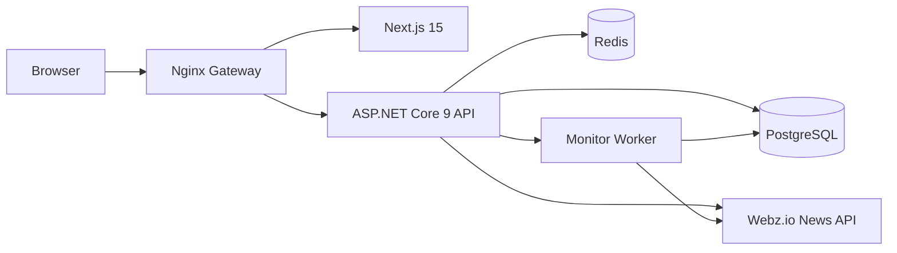

# Architecture

## Boundaries

- **Domain** contains entities and business state only.
- **Application** contains contracts, DTOs and service interfaces.
- **Infrastructure** owns EF Core, persistence, caching, Webz.io integration, authentication data and scheduled monitor execution.
- **API** owns HTTP, JWT issuance/validation, rate limiting and endpoint composition.
- **Frontend** is an independent Next.js client that talks only to the API.

## Data-flow

1. A user authenticates and receives an access token plus refresh token.
2. Search requests hit `INewsService`.
3. The active provider is selected by `Webz:Mode` (`Mock` or `Real`).
4. Real mode calls `GET https://api.webz.io/api/news` and keeps the Webz token server-side.
5. Monitor executions persist newly observed articles to PostgreSQL.
6. Dashboard queries aggregate persisted articles by time, source and sentiment.
7. Redis is used as an optional distributed cache for search results.
